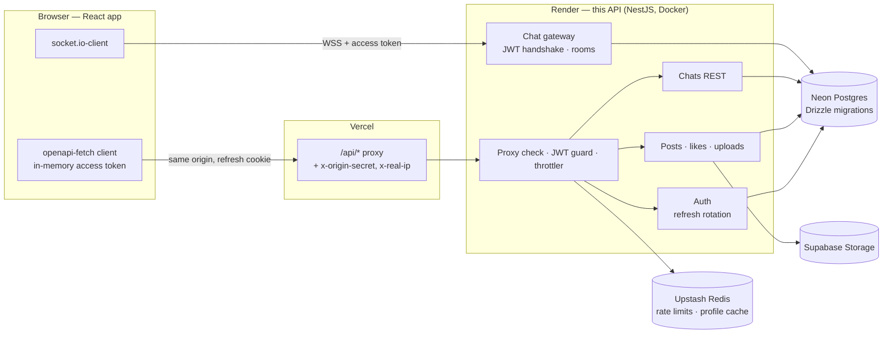

<h1 align="center">Pulse — API</h1>

<p align="center">
  The NestJS backend of Pulse, a real-time social network: profiles, image posts, likes and live chat.
</p>

<p align="center">
  <a href="https://github.com/ouvarov/nestSocialNetwork/actions/workflows/ci.yml"></a>
  <a href="https://pulse-social-henna.vercel.app"></a>
  <a href="https://pulse-social-henna.vercel.app/api/docs"></a>
  
</p>

**Live demo:** https://pulse-social-henna.vercel.app. Sign in as `ada@example.com` / `pulse-demo-password`. To chat with yourself, open a second window as `linus@example.com`.

> The free API host sleeps after 15 minutes idle, so the first request can take about a minute.

The web client lives in [ouvarov/viteSocialNetwork-](https://github.com/ouvarov/viteSocialNetwork-) (React 19, Vite, TanStack Query).

## Features

- **Auth**:
  - a short-lived access token;
  - rotating refresh tokens in an httpOnly cookie, with reuse detection that revokes the whole session;
  - logout revokes the session and closes the user's sockets on every device; other devices reconnect with their own refresh token;
  - emails are case-insensitive, passwords are capped at bcrypt's 72 bytes.
- **Account deletion** behind the password: posts and likes go, messages stay in the other person's chat without a sender, uploads are removed.
- **Posts with images:**
  - uploads go to Supabase Storage (local disk in dev);
  - the type and size are read from the file bytes, with a 5 MB limit;
  - the database stores storage keys in an `uploads` table, not URLs; a post or avatar references an upload by id, and only its owner can use it;
  - an image file is removed when nothing uses it anymore.
- **Profiles:** name, bio and avatar via `PATCH /users/me`; the cached profile is dropped on every write.
- **Follows:** idempotent `PUT` / `DELETE /users/:id/follow`; follower counts are cached with the profile, `isFollowedByMe` is computed per viewer.
- **Feed:** cursor pagination that stays stable while new posts arrive. Likes are idempotent and report `likedByMe` per viewer.
- **Direct chats:**
  - one chat per pair, enforced by a unique key, so a double click can't create two;
  - "delete for me" hides the history only for you; the chat comes back on a new message and is removed once nobody sees it;
  - history and the people list are cursor-paginated;
  - a non-member gets 404, as if the chat didn't exist.
- **Live messages** over Socket.IO: JWT handshake, sockets closed at token expiry and on logout, every event answered in its ack, validation.
- **Rate limits** stored in Redis:
  - 5 sign-in attempts per minute per visitor;
  - chat events limited per user;
  - the visitor IP is taken only from the trusted proxy;
  - Redis commands time out after 500 ms: limits then count in memory and the cache reads as a miss, so a Redis outage doesn't block sign-in.
- **Operations:**
  - liveness and readiness checks;
  - env validated with zod at startup;
  - one exception filter for HTTP and sockets that maps Postgres errors to 4xx;
  - migrations run on boot.

## Architecture



How the hosting fits together and why: [Deploy](#deploy).

## Tech stack — and why

| Layer            | Choice                            | Why                                                                                                  |
| ---------------- | --------------------------------- | ---------------------------------------------------------------------------------------------------- |
| Framework        | NestJS 12, TypeScript 6 (strict)  | Modules, DI and guards map well to auth plus realtime; Swagger comes from the same decorators        |
| Database         | PostgreSQL + Drizzle ORM          | SQL-first and typed, with migrations committed in `drizzle/`                                         |
| Realtime         | Socket.IO                         | Rooms, acks and reconnection out of the box                                                          |
| Cache and limits | Redis (optional)                  | Profile cache and shared rate limits; falls back to memory without `REDIS_URL`                       |
| Storage          | Supabase Storage / local disk     | One `StorageService` interface; no cloud account needed locally                                      |
| Contract         | Committed `openapi.json`          | The web client generates its types from it ([ADR-0001](docs/adr/0001-two-repos-openapi-contract.md)) |
| Config           | zod                               | The app refuses to start with a missing or weak secret                                               |
| Tests            | Jest, Supertest, socket.io-client | Unit tests for logic, e2e against a real Postgres                                                    |

## Run locally

Requires Node.js 24.9+ and PostgreSQL.

```bash
npm ci
cp .env.example .env   # set DATABASE_URL and the two JWT secrets (openssl rand -hex 32)
npm run db:migrate
npm run db:seed        # demo users: ada@, linus@, grace@example.com / pulse-demo-password
npm run start:dev
```

The API runs on http://localhost:5000, and Swagger UI is at http://localhost:5000/api/docs.

**With Docker**, nothing has to be installed except Docker:

```bash
cp .env.example .env   # set the two secrets
docker compose up --build
docker compose --profile seed up seed   # optional demo data
```

Nest 12 packages are ESM-only. The app stays CommonJS and loads them through `require(esm)`, which is why Jest runs with `--experimental-vm-modules`.

## Testing

```bash
npm test           # unit tests
npm run test:e2e   # e2e tests; needs E2E_DATABASE_URL pointing at a migrated, throwaway database
```

The e2e suite never reads `DATABASE_URL` from `.env`, so it can't touch a real database by accident.

Without Docker, an in-memory Postgres (PGlite) is enough:

```bash
npm run db:local                                             # terminal 1
DATABASE_URL=postgres://postgres@127.0.0.1:55432/postgres npm run db:migrate
E2E_DATABASE_URL=postgres://postgres@127.0.0.1:55432/postgres DATABASE_POOL_MAX=1 \
  npm run test:e2e -- --runInBand                            # terminal 2
```

PGlite runs one query at a time, so the pool is limited to one connection there.

- **Unit tests** (`src/**/*.spec.ts`) cover the logic, with the database mocked: token rotation and reuse, cursors, error mapping, env validation.
- **E2E tests** (`test/*.e2e-spec.ts`) start the whole app the way `main.ts` does, against a real Postgres. They use Supertest and a Socket.IO client. Coverage:
  - auth flows and refresh reuse;
  - posts, likes and pagination;
  - uploads;
  - direct chats, delete for me and history pages;
  - account deletion;
  - live messages;
  - rate limits and the proxy check;
  - CORS and health.
- **Tests that can fail:** for each suite I broke the code under test on purpose (a removed guard, a skipped revocation, a wrong tracker) and checked that a test failed.

E2E tests create users with unique emails and clean up their uploads, so they are safe to run against a dev database.

## API

- **Swagger UI:** [`/api/docs`](https://pulse-social-henna.vercel.app/api/docs). It is served through the same proxy as the app, so "Try it out" works. Sign in with `POST /api/auth/login`, then authorize with the returned token.
- **The spec:** `openapi.json` is generated from the controllers and committed.

  ```bash
  npm run openapi:generate   # rewrite openapi.json
  npm run openapi:check      # fail if it is out of date
  ```

- **Socket.IO events** (`joinChat`, `leaveChat`, `createMessage`, `newMessage`) are not part of OpenAPI. The client types them in `src/api/socket-events.ts`.
- **Health:** `GET /api/health/live` reports that the process is up. `GET /api/health/ready` checks Postgres and Redis and returns 503 naming the one that failed.

## Project structure

```text
src/
  auth/       register, login, refresh rotation, JWT strategy, socket auth
  user/       profiles (cached)
  post/       posts, likes, cursor pagination
  upload/     image upload, type detection from bytes
  chat/       chats and membership
  message/    Socket.IO gateway
  storage/    local disk and Supabase drivers behind one interface
  database/   Drizzle schemas, repositories, migrate and seed scripts
  common/     exception filter, throttler guard, proxy check, pagination
  config/     zod env schema
test/         e2e suites
drizzle/      SQL migrations
docs/adr/     architecture decisions
```

## CI

`.github/workflows/ci.yml` runs on every pull request and push to `main`:

| Job     | What it checks                                                       |
| ------- | -------------------------------------------------------------------- |
| Quality | type-check, ESLint, Prettier, `openapi.json` is up to date           |
| Unit    | Jest                                                                 |
| E2E     | migrations and the e2e suite on a Postgres service container         |
| Docker  | the image builds, migrations run and `/api/health/ready` answers 200 |

The web repo's CI also checks out this repo's `main` and runs its Playwright suite against it.

## Deploy

The demo runs on free tiers: the API on Render (Docker), Postgres on Neon, Redis on Upstash, images in Supabase Storage, and the web app on Vercel.

- **The browser calls the API through Vercel**, so the refresh cookie stays first-party. Safari blocks third-party cookies, so a direct cross-site call would sign users out on every reload.
- **Vercel adds a secret header.** `ORIGIN_SECRET` is required in production, and the API answers only requests that carry it. Health checks and Socket.IO are the exceptions. Because only proxied requests get through, the API can trust Vercel's `x-real-ip` for rate limits.
- **Socket.IO connects to Render directly**, because Vercel rewrites don't carry WebSockets. The token goes in the handshake, and chat events are limited per user.
- **The free instance sleeps after 15 minutes idle.** The web app pings `/api/health/live` directly and shows a "waking up" notice, so the proxy never waits on a sleeping instance.
- **Migrations run when the container starts**, because Render's pre-deploy command is paid only.

First deploy:

1. In Render, choose New → Blueprint → this repo; `render.yaml` defines the service.
2. Fill in `DATABASE_URL`, `REDIS_URL`, `ORIGIN_SECRET` (the same value goes to Vercel), `PUBLIC_URL`, `CORS_ORIGIN` (the Vercel URL), `SUPABASE_URL` and `SUPABASE_SERVICE_ROLE_KEY`. Render generates the JWT secrets.
3. Seed once:

   ```bash
   DATABASE_URL=<neon> NODE_ENV=production DEMO_MODE=true npm run db:seed
   ```

## Decisions and trade-offs

- **Two repos with a generated OpenAPI contract, not a monorepo.** Each side can be reviewed on its own, and CI catches contract drift. → [ADR-0001](docs/adr/0001-two-repos-openapi-contract.md)
- **Vite SPA instead of Next.js** on the web side. Everything is behind a login, and the API owns auth and sockets. → [ADR-0002](https://github.com/ouvarov/viteSocialNetwork-/blob/main/docs/adr/0002-vite-spa-not-next.md)
- **Access token in memory, rotating refresh cookie behind a same-origin proxy.** These are the XSS, CSRF and Safari trade-offs. → [ADR-0003](docs/adr/0003-auth-tokens.md)
- **Single instance.** The Socket.IO rooms live in memory. The Redis adapter is the path to more replicas.
- **Free-tier hosting.** Cold starts are accepted, and a wake-up notice explains them.

## What I'd do next

- Add the Socket.IO Redis adapter and run two API replicas behind a load balancer.
- Add notifications, read receipts and typing indicators.
- Add a personalised feed, plus full-text search with Postgres `tsvector`.
- Add OpenTelemetry traces across HTTP, sockets and the database.

## Scripts

| Script                           | What it does                         |
| -------------------------------- | ------------------------------------ |
| `npm run start:dev`              | Dev server with watch                |
| `npm run build`                  | Compile to `dist/`                   |
| `npm run check`                  | Type-check, ESLint and Prettier      |
| `npm test` / `npm run test:e2e`  | Unit / e2e tests                     |
| `npm run db:generate`            | Generate a migration from the schema |
| `npm run db:migrate` / `db:seed` | Apply migrations / load demo data    |
| `npm run db:local`               | In-memory Postgres for e2e (PGlite)  |
| `npm run openapi:generate`       | Regenerate `openapi.json`            |

## License

[MIT](LICENSE) © Oleksandr Uvarov
